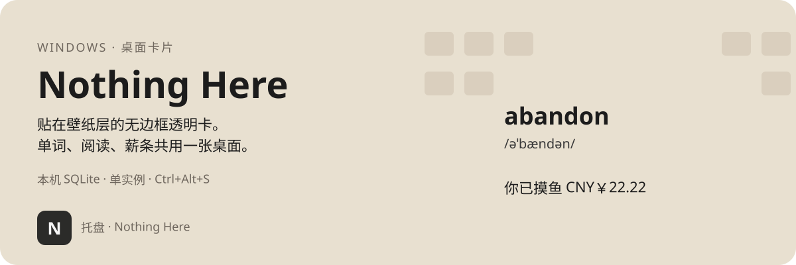
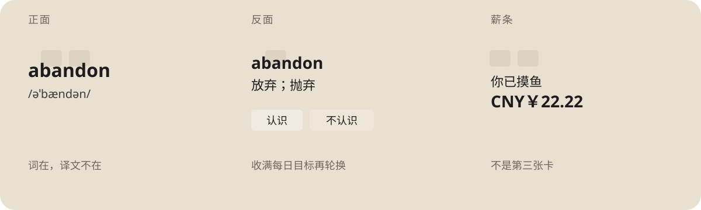

<p align="center">
  
</p>

Nothing Here 是一个贴在壁纸层（或浮在窗口上）的轻量摸鱼卡片。任务栏托盘名称是 **Nothing Here**。同一时间只运行一个实例。

现在可用的功能面是**单词**（含拼写测试）和**阅读**。托盘里的**考试**仍是预留入口。

<p align="center">
  
</p>

## 现在能做什么

| 能力 | 说明 |
| --- | --- |
| **背单词** | 雅思 / 四级 / 六级 / 考研 / 日语；音标或读音、释义、词条例句 |
| **拼写测试** | 达到一定正确率后会发出邀请进入 / 主动在托盘触发 |
| **每日目标** | 「不认识」收入名单，满足今日背诵目标数量后进入抽查模式（会附带复习） |
| **斩杀与回收站** | 熟练词可移出抽卡池，托盘里恢复 |
| **风格** | 极简无痕：浅色、黑底白字、自定义文字色 |
| **桌面嵌入** | 默认紧贴桌面，可调节为「浮在窗口上」，支持随时随地摸鱼 |
| **阅读** | 导入 txt、md、html、epub、docx、odt、fb2阅读，会记录阅读位置 |
| **摸鱼计时** | 薪条按工作时段累计今日摸鱼薪资，托盘可打开摸鱼统计看板 |
| **隐藏热键** | Ctrl+Alt+S一键全部隐藏，也可以切换卡片单独隐藏状态 |
操作说明：[`使用教程.md`](使用教程.md)。术语以 [`GLOSSARY.md`](GLOSSARY.md) 为准。

## 环境

- Windows 10 及以上
- Python 3.9+（开发常用 3.12 / 3.14）
- 依赖见 [`requirements.txt`](requirements.txt)：`PyQt6`、`PyQt6-WebEngine`、`pynput`

若前台有**管理员权限**程序占用全局热键，需用管理员身份启动，或先离开该程序。

## 跑起来

```powershell
git clone https://github.com/yuanzal/nothing-here.git
cd nothing_here

py -3 -m venv .venv
.\.venv\Scripts\python.exe -m pip install -r requirements.txt
.\.venv\Scripts\python.exe run.py
```

等价：

```powershell
$env:PYTHONPATH = "src"
.\.venv\Scripts\python.exe -m nothing_here
```

系统托盘：深色圆角 **N**，悬停 **Nothing Here**。右键打开托盘进行控制，显隐卡片、风格、功能面、摸鱼计时。

进度文件：`%APPDATA%\NothingHere\study.db`

## 开发与测试

```powershell
$env:PYTHONPATH = "src"
$env:QT_QPA_PLATFORM = "offscreen"
.\.venv\Scripts\python.exe -m unittest discover -s tests
```

```
src/nothing_here/
  app.py           # 组装、生命周期、单实例
  domain/          # 权重、抽卡、每日目标、拼写、阅读、摸鱼（无 Qt / 无库）
  vocab/           # 词库协议、例句来源协议
  storage/         # SQLite
  ui/              # 卡片、薪条、托盘
  desktop/         # Windows 桌面嵌入
  input/           # 全局热键、拼写键钩子
data/*.json        # 词库 JSON
scripts/           # 词库构建、例句填充（离线；运行时不联网）
```

规格：[`开发文档.md`](开发文档.md)、[`需求变更.md`](需求变更.md)、[`需求变更-第1阶段.md`](需求变更-第1阶段.md)、[`需求变更-第2阶段.md`](需求变更-第2阶段.md)、[`需求变更-第3阶段.md`](需求变更-第3阶段.md)、[`GLOSSARY.md`](GLOSSARY.md)。

## 扩展性

| 扩展点 | 现在好不好扩 | 说明 |
| --- | --- | --- |
| **词库** | 好扩 | `VocabSource` 协议 + `load_sources()`；加 JSON 或自写实现即可 |
| **例句来源** | 好扩 | `ExampleSource` 协议；可串联，先命中先用 |
| **功能面** | 单词、阅读可用 | 考试仍只是菜单口；没有统一的 Surface 注册表 |
| **拼写测试** | 挂在单词面下 | 是单词功能面里的卡态，不是第四个功能面 |

**词库 / 例句已经是可插拔接口**；**新功能面还要自己接 `app` / `ui` / `domain`，不是注册一项就跑起来。**

<details>
<summary>词库接口</summary>

### 协议

```python
# src/nothing_here/vocab/protocol.py
@dataclass(frozen=True)
class Entry:
    word: str
    phonetic: str
    translation: str
    example: str = ""

class VocabSource(Protocol):
    source_id: str      # 唯一，如 "cet4"
    display_name: str   # 托盘词表名，如 "四级" / "N3"
    family: str         # 托盘一级目录，如 "英语" / "日语"
    def iter_entries(self) -> Iterable[Entry]: ...
```

- 进度键是 `word.casefold()`，**不**带 `source_id`；换词库共用同一进度行。
- 应用只通过协议读词，不要在 `app` 里写死某个 JSON 路径。

### 方式 A：加一份 ECDICT JSON（最常见）

1. 准备 ECDICT 的 `ecdict.csv`（勿提交进仓库）。
2. 导出（tag 须在 CSV 的 `tag` 字段里按空白切开后**精确匹配**）：

   ```powershell
   .\.venv\Scripts\python.exe scripts\build_ecdict.py path\to\ecdict.csv --tag toefl -o data\toefl.json
   # 或一次导出已知 tag：
   .\.venv\Scripts\python.exe scripts\build_ecdict.py path\to\ecdict.csv --all
   ```

3. 补例句（Tatoeba + 有道双语；**不**生成模板句）：

   ```powershell
   .\.venv\Scripts\python.exe scripts\example_sentences.py data\toefl.json
   ```

4. 注册到 [`src/nothing_here/vocab/registry.py`](src/nothing_here/vocab/registry.py)：

   ```python
   def load_sources() -> list[VocabSource]:
       return [
           # ...已有...
           JsonVocabSource("toefl", "托福", data_file("toefl.json"), "英语"),
       ]
   ```

5. 把 JSON 加进 [`scripts/nothing_here.spec`](scripts/nothing_here.spec) 的 `datas`，否则打包版里没有该文件。

JSON 形态：

```json
[
  {
    "word": "abandon",
    "phonetic": "əˈbændən",
    "translation": "放弃；抛弃",
    "example": "He decided to abandon the project."
  }
]
```

### 方式 B：自写 `VocabSource`

实现 `source_id` / `display_name` / `family` / `iter_entries()`，在 `load_sources()` 里追加即可。数据可以来自别的文件格式或只读远程镜像，只要返回 `Entry`；**运行时是否联网由你自己约束**（现有词库约定：运行时不联网）。

### 例句来源

```python
# src/nothing_here/vocab/examples.py
class ExampleSource(Protocol):
    source_id: str
    def example_for(self, word: str) -> str: ...
```

当前只有 `EntryExampleSource`（读词条上的 `example` 字段）。要加第二来源：实现协议 → 放进 `load_example_sources()` 列表；`resolve_example` 按顺序取第一个非空结果。

### 已带词库

| source_id | 托盘名 | 文件 | ECDICT tag |
| --- | --- | --- | --- |
| `ielts` | 雅思 | `data/ielts.json` | `ielts` |
| `cet4` | 四级 | `data/cet4.json` | `cet4` |
| `cet6` | 六级 | `data/cet6.json` | `cet6` |
| `ky` | 考研 | `data/ky.json` | `ky` |
| `jp_n5` … `jp_n1` | N5–N1 | `data/jp_n5.json` … | OpenJLPT 词表 + Tomoshi 中文释义 |

- 重建英语词库：`python scripts/build_ecdict.py path/to/ecdict.csv --all`
- 重建日语词库：`python scripts/build_jlpt.py`（按 N5–N1 各写一份；缓存 `data/cache/openjlpt/` 与 `data/cache/tomoshi/` 已 gitignore。首次需要能解压 `.zst` 的 `zstandard`）
- 补英语例句：`python scripts/example_sentences.py data/cet4.json data/cet6.json data/ky.json`  
  （会下载/使用 `data/cache/` 下的 Tatoeba 导出；该目录已 gitignore）
- **应用运行时不访问网络。** 拼写输入不另做日语模式，交给系统输入法。

</details>

<details>
<summary>增加功能面</summary>

托盘「功能面」有「单词 / 阅读 / 考试」。`surface_id` 为 `word` 或 `read`。点「考试」仍会留在当前这一面。阅读的翻页规则在 `domain/read.py`，epub 等格式抽正文在 `domain/formats.py`，书和进度在 `storage`，卡片在 `ui/read_window.py`。

卡片（`CardWindow`）、桌面嵌入、热键、风格是**容器级**能力；单词抽卡、打分、拼写都写在「单词」这条链路里。**还没有**类似 `VocabSource` 的 `Surface` 注册表。预留的是产品与菜单口子，**不是**「实现一个类 + 注册一行就出新功能面」。

若要真正加一面（以「考试」为例）：先在 `GLOSSARY.md` 和对应 `需求变更-*.md` 写清规格，再在 `domain/` 加纯规则、`storage` 加表、`ui` 加展示、`tray` 发出真实 `surface_id`，最后在 `app.py` 的 `choose_surface` / `_render` 分支。拼写属于单词面，不要占新的 `surface_id`。在出现稳定的 `Surface` 协议之前，**每加一面都要改 `app` + `tray` + `card`**。

</details>

## 设计原则

- **本地优先**：进度、风格、位置、每日状态落 SQLite。
- **可测领域层**：`domain` 不依赖 PyQt、pynput 或具体 DB。
- **词库 / 例句可插拔**：协议 + 注册表。
- **功能面渐进**：先单词跑通，再按规格加面，而不是先做空框架。

## 发布

推送 `v*` tag 会触发 Actions：打包 Windows zip 并挂到 Release。

```powershell
git tag v0.3.0
git push origin v0.3.0
```

本地试打包：`.\scripts\build_release.ps1` → `dist\NothingHere-<version>-win64.zip`（版本取自 `src/nothing_here/__init__.py`）。

Tag 页上的 Source code zip 只是源码；安装包在 **Releases** 的 Assets 里。

## 贡献与许可

欢迎 Issue 与 PR。扩展词库或功能面前请对照 `GLOSSARY.md` 与变更文档，避免和单卡模型、已有术语冲突。

许可证：MIT。详见 [`LICENSE`](LICENSE)。第三方组件遵循各自协议。
